# Weekly Assignment 7: Infrastructure as Code

Student: anasaemd
Platform: CSC cPouta and OpenTofu
GitHub Repository: https://github.com/anasaemd25/cloud-services-assignment-7
Website: https://frontend-cloud-services-assignment-2.2.rahtiapp.fi/assignment7.html

## Part A: Theoretical Questions

### 1. What is Infrastructure as Code (IaC), and which problems of manually created infrastructure does it solve?

Infrastructure as Code (IaC) is an IT management paradigm where compute instances, virtual networks, firewall rules, storage volumes, and routing policies are provisioned and managed using machine readable definition files rather than interactive graphical web consoles or ad hoc terminal commands. These definition files are stored in version control systems such as Git and are treated with the same rigor as application software, including code reviews, automated testing, versioning, and continuous integration pipelines.

In Week 1, I built an Apache web server manually on CSC cPouta (an OpenStack based IaaS platform). That process required clicking through the OpenStack dashboard to create a security group, opening TCP ports 22 and 80 by hand, generating a key pair, launching a Ubuntu virtual machine, attaching a public floating IP, opening an SSH terminal, and manually executing commands like `sudo apt update` and `sudo apt install apache2`.

Key Problems Solved by IaC:

- Human Error and Inconsistency: When building infrastructure manually, it is easy to forget a critical step, such as applying a firewall rule, setting the correct image flavor, or configuring line endings. If I had to rebuild my Week 1 setup from memory months later, small inconsistencies would inevitably occur. IaC guarantees that every run produces an identical environment because the definition is codified.
- Configuration Drift: Over time, live environments often diverge from their original design when administrators make quick fixes directly in the web console. IaC engines detect these discrepancies (drift) by comparing live API states against declared code definitions, allowing teams to automatically revert unapproved manual changes.
- Speed and Operational Scalability: Provisioning a complex multi tier application by clicking through a web GUI takes 15 to 30 minutes of labor per environment. With OpenTofu, running `tofu apply` creates the VM, configures the virtual network ports, assigns security groups, allocates a floating IP, and provisions Apache via `cloud_init` in less than 30 seconds.
- Traceability and Collaboration: When infrastructure is defined in Git, every infrastructure change is tied to a specific commit, author, and pull request. If a firewall change causes an outage, teams can review Git logs or instantly revert to a previous working commit.

### 2. Explain the difference between declarative and imperative infrastructure automation. What does idempotency mean, and why is it important?

The difference between declarative and imperative automation lies in whether you define what end state you want or how the execution steps should be performed:

- Declarative Automation (for example OpenTofu, Terraform, Kubernetes manifests): In a declarative model, the engineer defines the desired final state of the infrastructure in code (for example "I want 1 virtual machine with flavor standard.tiny, connected to security group web_sg"). The automation tool is responsible for discovering the current live state, calculating the difference, and making the necessary cloud API calls to reach the target state. You do not specify individual build steps or execution logic.
- Imperative Automation (for example Bash scripts, Python scripts using OpenStack CLI commands): In an imperative model, the engineer writes explicit step by step instructions describing how to achieve a result (for example "Step 1: Check if network exists; Step 2: Run openstack server create; Step 3: Sleep 10 seconds; Step 4: Attach floating IP"). If a step fails mid execution, the script often breaks, leaving the system in an inconsistent intermediate state that requires manual cleanup.

Idempotency: Idempotency is a property of an operation where executing it multiple times produces the exact same outcome without creating duplicate resources or unintended side effects.

Why Idempotency is Crucial in Cloud Automation: If you run an imperative shell script containing `openstack server create` twice, it will spin up two separate virtual machines, doubling your infrastructure cost and causing potential IP conflicts. In contrast, an idempotent tool like OpenTofu reads its state file during execution. If you run `tofu apply` a second time without modifying your `.tf` code, OpenTofu queries the OpenStack API, sees that the VM and floating IP already match the declared code, and outputs `Apply complete! Resources: 0 added, 0 changed, 0 destroyed`. This allows developers to run automation pipelines safely and repeatedly without fear of breaking live infrastructure.

### 3. Why was OpenTofu created? Compare Terraform and OpenTofu. Would the choice between them matter to you as a developer, or to a company?

Why OpenTofu was Created: For over a decade, HashiCorp Terraform was the industry standard open source IaC tool released under the Mozilla Public License v2 (MPL 2.0). However, in August 2023, HashiCorp unexpectedly changed Terraform's license to the restrictive Business Source License 1.1 (BUSL). This new license restricted commercial usage, preventing companies from using Terraform to build competing hosted platforms or commercial tools. In response, a broad consortium of companies, open source developers, and foundations created OpenTofu, a fully open source, community governed fork under the neutral Linux Foundation.

Comparison: Developer Perspective vs Company Perspective:

- As a Developer: The choice between OpenTofu and Terraform makes virtually no practical difference day to day. Both tools share identical HashiCorp Configuration Language (HCL) syntax, use the exact same OpenStack/AWS/Azure provider plugins, share CLI commands (`init`, `plan`, `apply`, `destroy`), and read the exact same `.tf` configuration files. Migration between them is a drop in binary replacement.
- As a Company: The choice is significant. Using BUSL licensed Terraform introduces potential legal risks, licensing costs, and vendor lock in, especially for cloud service providers, SaaS vendors, and enterprise internal developer platforms. OpenTofu, governed by the Linux Foundation under the permissive MPL 2.0 license, guarantees long term open source stability, vendor neutrality, transparent community development, and zero licensing fees.

### 4. What is the state file used for? Why should it not be committed to a Git repository, and how do teams usually share it instead?

Purpose of the State File (`terraform.tfstate`): The state file is a JSON document generated by OpenTofu that maintains a mapping between the abstract resource blocks declared in your `main.tf` code and the actual real world object IDs generated by cloud provider APIs (such as OpenStack UUIDs, floating IP addresses, and network interface MAC addresses). During `tofu plan`, OpenTofu reads the state file to calculate structural dependencies, detect configuration drift, and determine which resources need to be updated in place or replaced.

Why the State File Must NEVER Be Committed to Git:

1. Exposure of Sensitive Credentials and Secrets: OpenTofu writes raw infrastructure attributes into the state file in unencrypted plain text. This includes sensitive information such as initial database root passwords, TLS private keys, service account tokens, and internal private network topology. Committing a `.tfstate` file to a public GitHub repository exposes those credentials to the public.
2. State File Corruption and Race Conditions: If multiple team members commit and push conflicting local state files to Git, Git merges will corrupt the state mapping, causing OpenTofu to lose track of real cloud resources or accidentally delete live production infrastructure.

How Teams Share State Files Securely: Rather than storing state locally on a developer's laptop, engineering teams use Remote Backends. Common solutions include AWS S3 buckets (or CSC Allas S3 compatible object storage), OpenTofu Cloud, or HashiCorp Consul. These remote backends enforce two essential operational controls:

- Encryption at Rest and in Transit: State data is encrypted using AES 256 before being written to disk, and managed using strict IAM access policies.
- State Locking: When an engineer or CI/CD pipeline runs `tofu apply`, OpenTofu places an automated lock on the remote state file (for example using AWS DynamoDB). This prevents other team members from running concurrent operations that could corrupt the infrastructure.

## Part B: Hands On: Rebuild Your VM as Code

In this hands on exercise, I rebuilt the Week 1 web server entirely from code using OpenTofu on CSC cPouta.

### Repository and Code Structure

All infrastructure code is stored in my public GitHub repository: cloud_services_assignment_7

- `main.tf`: Defines the core OpenStack infrastructure resources.
- `versions.tf`: Specifies the OpenStack provider version requirement.
- `variables.tf`: Declares input variables with default values, types, and descriptions.
- `outputs.tf`: Defines outputs that print the public IP address and website URL upon deployment.
- `cloud_init.yaml`: Defines post boot instructions to update packages, install Apache, and write a custom `index.html` page showing my name.
- `.gitignore`: Protects sensitive files like state files (`*.tfstate`) and OpenStack credential scripts (`*_openrc.sh`) from being committed.

### Breakdown of main.tf Resources

- `data "openstack_networking_network_v2" "project"`: Looks up the existing CSC project network (`project_2020476`).
- `resource "openstack_compute_keypair_v2" "web"`: Uploads my local public SSH key (`~/.ssh/id_rsa.pub`) to cPouta.
- `resource "openstack_networking_secgroup_v2" "web"`: Creates a dedicated firewall security group.
- `resource "openstack_networking_secgroup_rule_v2" "ssh"` and `"http"`: Restricts SSH (port 22) access to my personal IP address and allows HTTP (port 80) traffic from anywhere.
- `resource "openstack_networking_port_v2" "web"`: Attaches a network port inside the project network protected by the security group.
- `resource "openstack_compute_instance_v2" "web"`: Provisions the Ubuntu 22.04 VM, attaches the key pair, and injects the `cloud_init.yaml` script.
- `resource "openstack_networking_floatingip_v2" "web"`: Allocates a public floating IP from the public pool and binds it to the VM's network port.

### Initial Infrastructure Deployment

After authenticating with `source project_2020476_openrc.sh`, I executed `tofu init`, `tofu plan`, and `tofu apply`.

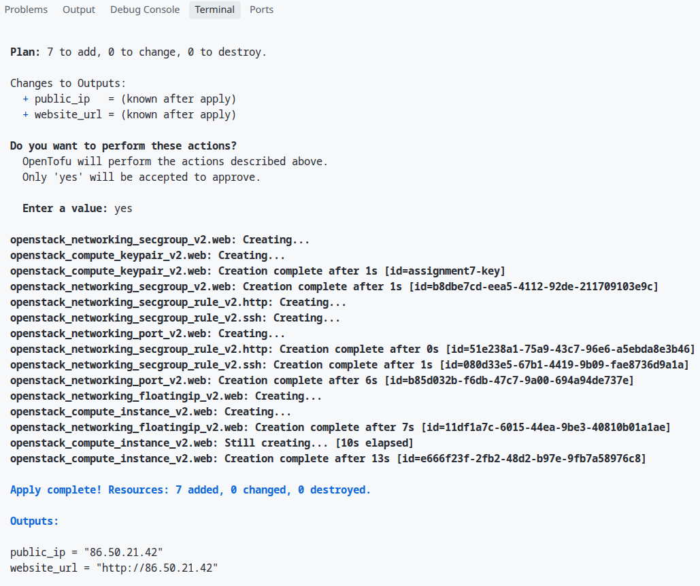

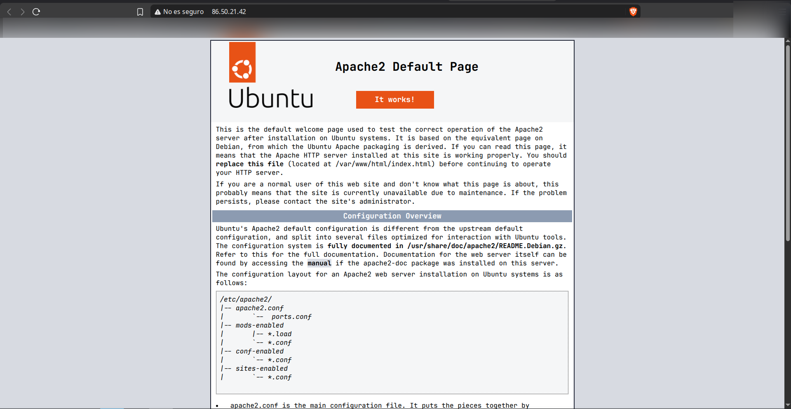

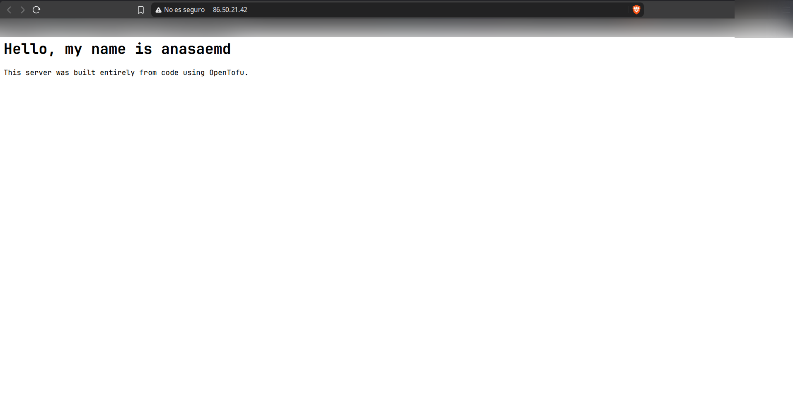

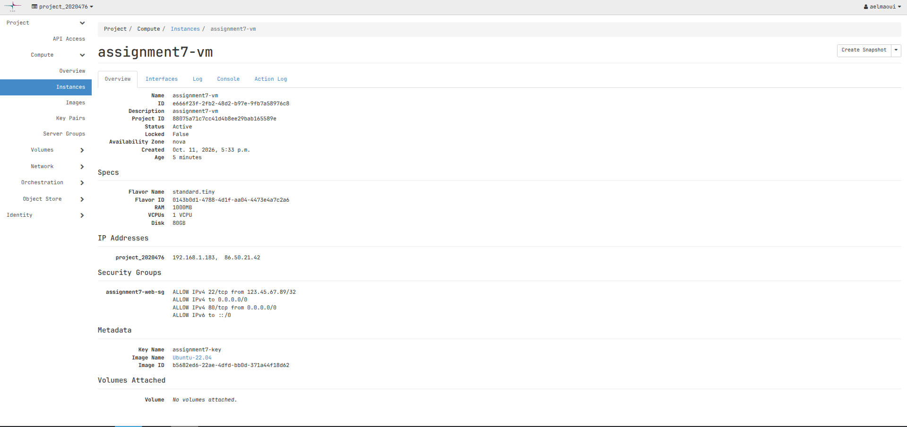

## OpenTofu Experiments

### Experiment 1: Code Modifications (In Place vs Replacement)

Prediction:

I modified two parts of the code:

1. Updated the security group description in `main.tf`. Prediction: Updated in place (no VM recreation needed because OpenStack allows metadata updates directly).
2. Updated the `page_message` variable in `variables.tf`. Prediction: Requires VM replacement (destruction and recreation) because `user_data` / `cloud_init` scripts are executed only once during the initial instance boot phase.

Results and Evidence:

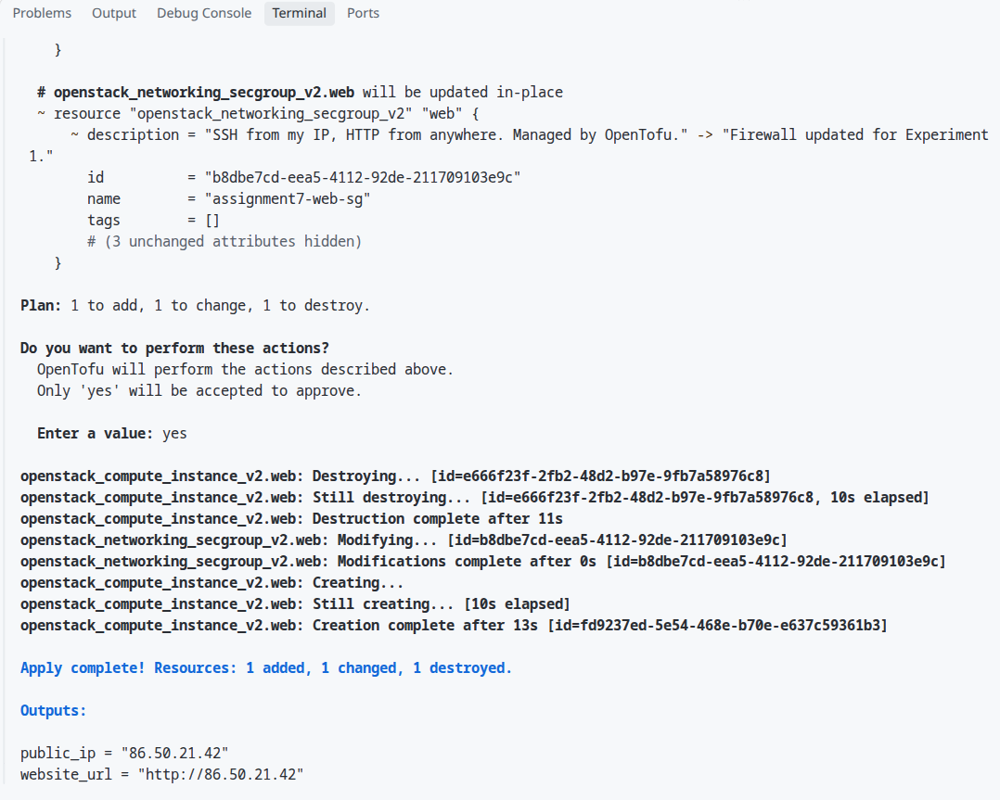

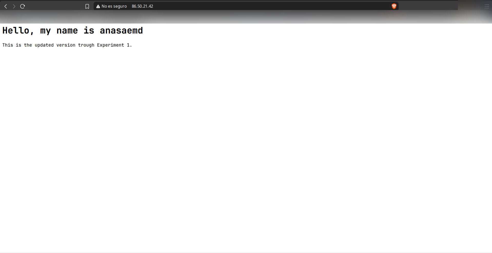

Explanation:

OpenTofu distinguishes between mutable parameters (like firewall descriptions) that can be changed via API calls without interrupting running services, and immutable parameters (like `user_data` initialization scripts) that cannot be altered after a virtual machine has been provisioned. To apply the new `user_data`, OpenTofu destroyed the existing instance and created a new one.

### Experiment 2: Configuration Drift

Prediction:

I manually modified the security group description in the CSC cPouta web console to "Updated manually from the web console."
Prediction: Running `tofu plan` will detect this manual change (configuration drift) by comparing real world infrastructure against the local state file and will propose updating the firewall back to match the code in `main.tf`.

Results and Evidence:

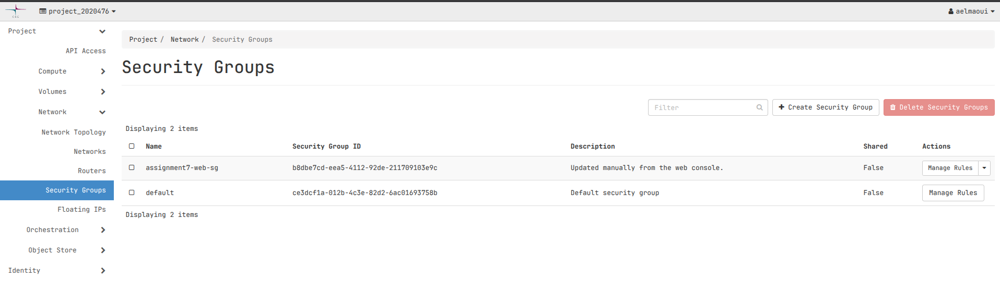

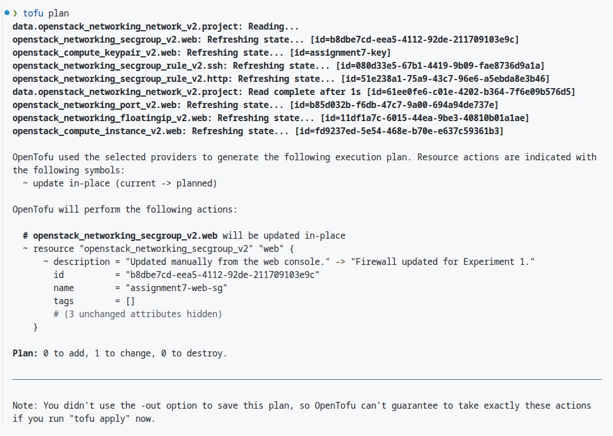

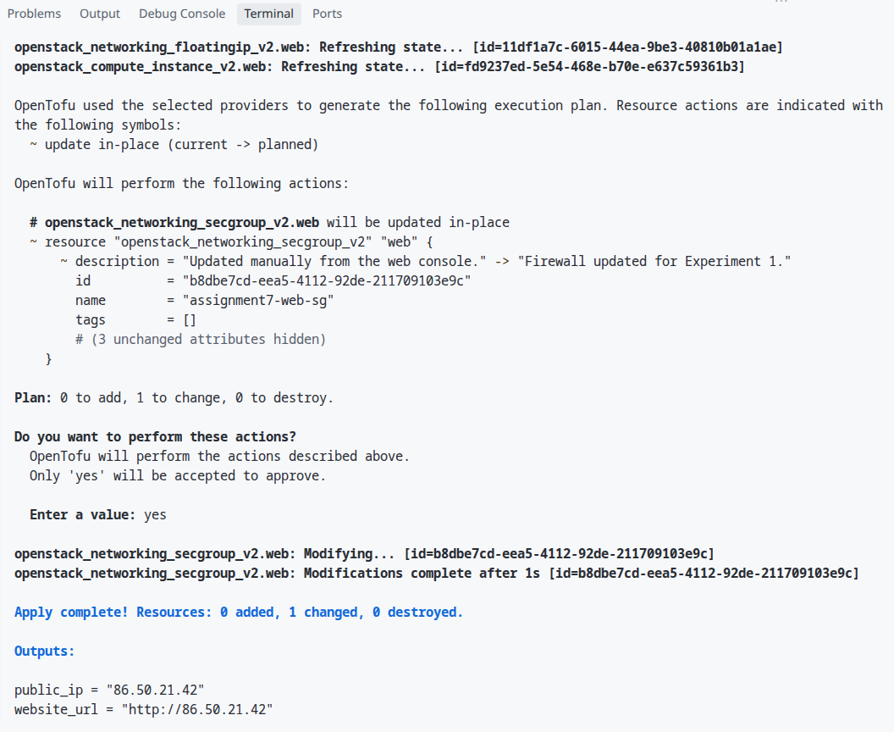

Explanation:

When `tofu plan` runs, OpenTofu queries the OpenStack API to refresh the actual live state of the cloud resources and compares it against the declared state in `main.tf`. Because the code is the single source of truth, OpenTofu detected that the live security group description differed from the code and generated an execution plan to overwrite the manual console change, returning the firewall back to code specification.

### Experiment 3: Destroy and Rebuild

Prediction:

Destruction Prediction: Running `tofu destroy` will dismantle resources in reverse order of their dependency graph (VM instance and Floating IP first, followed by network port, firewall rules, security group, and SSH key pair).
Rebuild Prediction: Running `tofu apply` again will rebuild the entire working web server environment from scratch automatically without any manual intervention.

Results and Evidence:

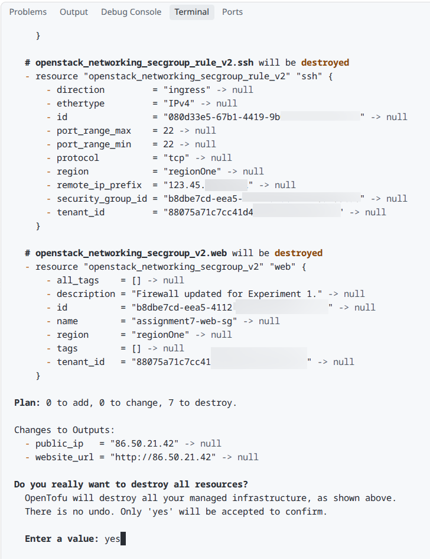

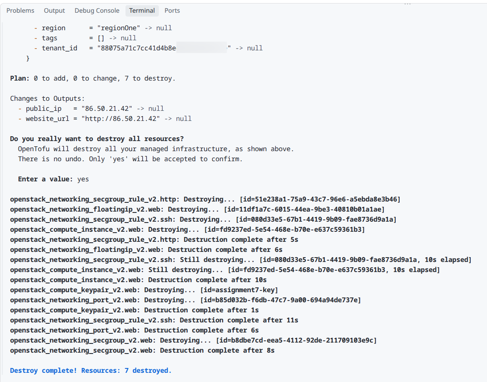

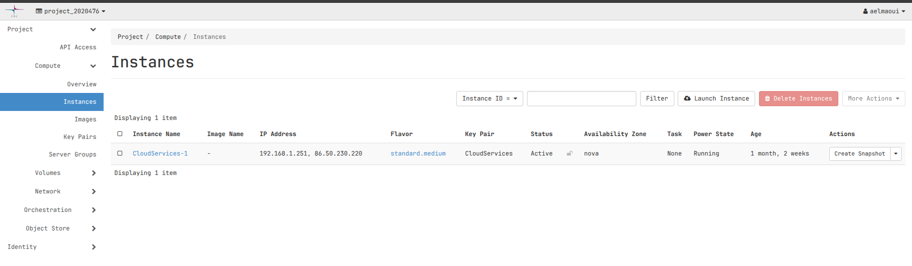

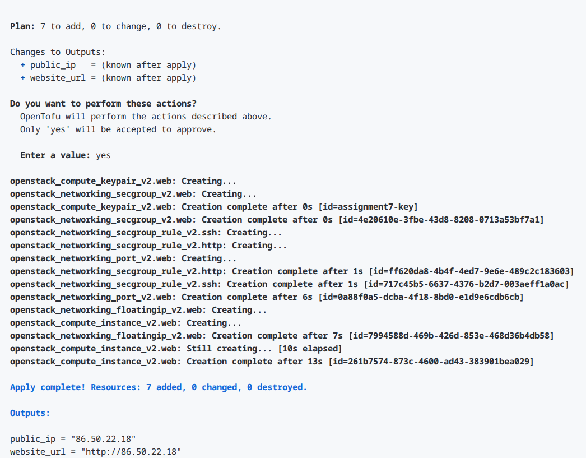

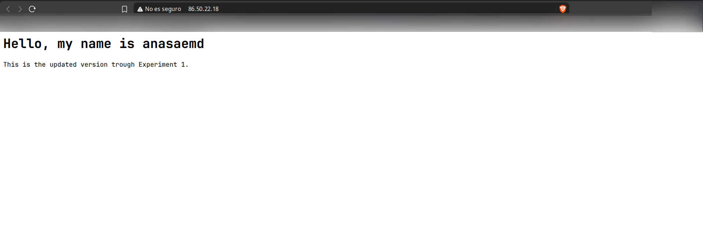

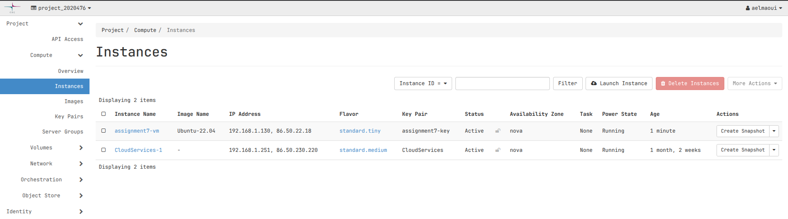

Explanation:

OpenTofu manages resources using a directed acyclic graph (DAG) of dependencies. During `tofu destroy`, dependent resources (like instances and floating IPs attached to network ports) are deleted before the underlying network ports or security groups can be safely removed. Upon running `tofu apply`, OpenTofu recreated the exact environment from code, demonstrating complete infrastructure repeatability.

## Reflection and Comparison

Comparing manual VM setup (Week 1) with Infrastructure as Code (Week 7):

- Effort and Speed: In Week 1, manually creating the VM, setting up security rules, assigning IPs, logging in over SSH, and configuring Apache required over 15 minutes of manual labor. In Week 7, writing the code took initial thought, but deploying and rebuilding the entire setup took less than 30 seconds with a single command.
- Repeatability and Reliability: Manual setups are hard to document perfectly and vulnerable to human error. IaC allows identical infrastructure environments to be created reliably across testing, staging, and production.
- Security: Manual setups often lead to open firewall rules or misplaced SSH keys. IaC keeps security group rules strictly defined in code, validated, and version controlled.
- When to use each: Manual setups are suitable for quick one off testing or learning. IaC is essential for production cloud engineering, team collaboration, and scalable software systems.

## Troubleshooting Log

Problem 1: Missing SSH Key Pair
Symptom: `tofu plan` failed with error `no file exists at "/home/anas/.ssh/id_rsa.pub"`.
Solution: Generated a standard RSA SSH key pair locally using `ssh_keygen` without passphrase.

Problem 2: OpenStack Authentication Session Expiration
Symptom: OpenTofu commands returned `Error creating OpenStack networking client: Authentication failed`.
Solution: Re loaded the OpenStack environment variables into the active terminal session using `source project_2020476_openrc.sh` and entered the cPouta account password.
